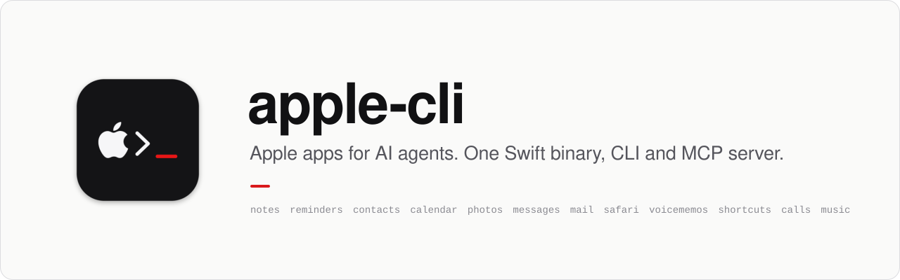
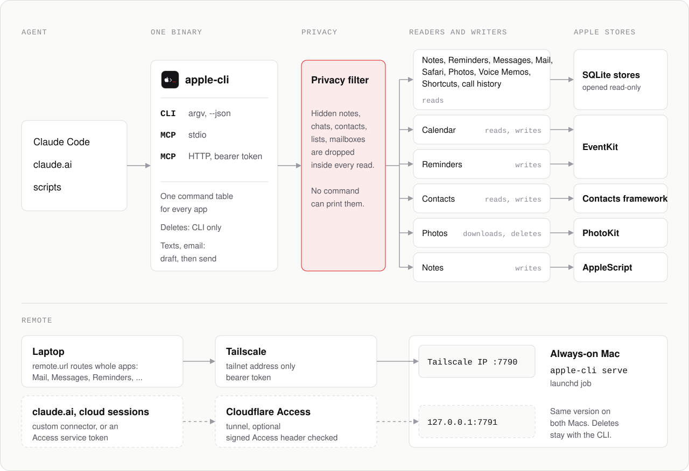

<picture>
  <source media="(prefers-color-scheme: dark)" srcset="docs/media/banner-dark.svg">
  
</picture>

apple-cli gives AI agents fast access to 12 Apple apps on a Mac: Notes, Reminders, Contacts, Calendar, Photos, Messages, Mail, Safari, Voice Memos, Shortcuts, call history, and Music. One Swift binary is both the CLI and an MCP server.

<p align="center">
  
</p>

## What it does

- **Fast reads.** Reads go directly to the store of each app, read-only. Notes and Reminders reads take 15 to 250 ms.
- **Official writes.** Writes use EventKit, the Contacts framework, or AppleScript for Notes. No command writes to an app database, so iCloud sync stays correct.
- **Drafts before sends.** A text or email goes out only after a person approves the draft.
- **Privacy rules.** Hidden notes, chats, contacts, calendars, and mailboxes never print and never show in search.
- **No deletes over MCP.** Deletes are CLI only.

<p align="center">
  
</p>

## How it works

<picture>
  <source media="(prefers-color-scheme: dark)" srcset="docs/media/architecture-dark.svg">
  
</picture>

apple-cli reads SQLite only when the official API stops, is slow, or does not show the necessary data. [docs/architecture.md](docs/architecture.md) gives the reason for each app.

## Install

1. Build, sign, and link apple-cli.

   ```bash
   Support/install.sh
   ```

2. Answer the permission prompts.

   ```bash
   apple-cli permissions --request
   ```

3. Drag AppleCLI.app into the Full Disk Access list, and turn it on.

> [!NOTE]
> Do step 2 in a logged-in session, not over SSH. The permissions belong to AppleCLI.app. Thus, they apply to each caller and stay after a rebuild.

## Use it with an agent

Add apple-cli as an MCP server on stdio. For Claude Code:

```bash
claude mcp add apple-cli -- apple-cli mcp
```

It gives 84 tools. Deletes are not tools.

<p align="center">
  
</p>

## Run it as a server on an always-on Mac

```bash
apple-cli serve --host <tailscale-ip> --token-file ~/.config/apple-cli/server-token --writes
```

Run this command on a Mac that stays on, as a launchd job. The server listens only on the Tailscale address, port 7790. Each request must have the bearer token. Without `--writes`, the server is read-only.

<details>
<summary>Connect from claude.ai, and send whole apps from a laptop</summary>

#### Connect from claude.ai and cloud sessions

Add `--access-port 7791 --access-team TEAM --access-aud TAG` to start a second listener on `127.0.0.1:7791`. Put a Cloudflare tunnel and a Cloudflare Access app in front of it.

apple-cli examines the signed `Cf-Access-Jwt-Assertion` header on each request. It compares the header with the keys of the team and the audience tag of the app. If a request did not go through Access, apple-cli refuses it.

| Caller | How it connects | What it can do |
|---|---|---|
| claude.ai | Custom connector with the `/mcp` URL of the tunnel. Access does the login. | Reads, writes, and sends |
| Cloud sessions and scripts | Access service token in the `CF-Access-Client-Id` and `CF-Access-Client-Secret` headers | Reads, drafts, and edits. No `mail_send` or `messages_send`. |
| Local CLI | CLI token | All of the above, plus deletes |

If you do not give `--access-port`, the second listener does not start.

#### Send whole apps to the server

On a laptop, set `remote.url` in `~/.config/apple-cli/config.json` to the always-on Mac. Then each command for Mail, Messages, Reminders, Calendar, Contacts, and Notes runs on that Mac. The output ends with `(ran on the mini)`. To change the list of apps, set `remote.apps`.

All of the commands for one app go to the same Mac. The reason is that IDs are different on each Mac. An event ID from one Mac can identify nothing, or a different event, on the other Mac.

- Music, Photos, Safari, Voice Memos, call history, Shortcuts, `person`, `today`, `search`, `permissions`, and `doctor` run on the laptop.
- If the server is not available, a routed command stops with a clear error. It does not run on the laptop.
- To run one command on the laptop, add `--local`, or set `APPLE_CLI_LOCAL=1`.
- Both Macs must have the same version. If the versions are different, the router refuses the command.
- Notes and Mail update their local copies only while they are open. On the server, open them again in the background on a schedule.

</details>

## Commands

Add `--json` to a command to get JSON output.

<details>
<summary>All commands</summary>

```
apple-cli notes list [--folder NAME] [--limit N]
apple-cli notes folders
apple-cli notes search <query> [--limit N]
apple-cli notes read <id>
apple-cli notes create <title> [--body MARKDOWN] [--folder NAME]
apple-cli notes append <id> <markdown> [--force]
apple-cli notes trash <id>                      CLI only
apple-cli reminders list [--list NAME] [--completed] [--limit N]
apple-cli reminders due-today
apple-cli reminders add <title> [--at WHEN] [--list NAME] [--notes TEXT] [--priority N]
apple-cli reminders complete <id>
apple-cli reminders move <id> --at WHEN
apple-cli reminders delete <id>                 CLI only
apple-cli contacts list [--group NAME] [--limit N]
apple-cli contacts search <name, email, or phone>
apple-cli contacts read <id>
apple-cli contacts groups
apple-cli contacts duplicates
apple-cli contacts create [--first] [--last] [--org] [--email work=a@b.com,…] [--phone mobile=+1…] [--birthday YYYY-MM-DD] [--group NAME]
apple-cli contacts update <id> [--first …] [--add-email …] [--remove-email …] [--add-phone …] [--remove-phone …]
apple-cli contacts delete <id>                  CLI only
apple-cli messages chats [--limit N] [--no-names]
apple-cli messages read <chat> [--limit N | --all] [--since WHEN] [--before WHEN]
apple-cli messages search <query> [--chat …] [--from name|phone|email|me] [--since WHEN]
apple-cli messages unread [--since WHEN]
apple-cli messages stats
apple-cli photos stats | storage [--by …] | top | videos | albums
apple-cli photos list [--album …] [--since …] [--kind …]
apple-cli photos download <ids> [--to …]
apple-cli photos delete <ids>                   CLI only
apple-cli calendar calendars | today
apple-cli calendar agenda [--days N] [--from …] [--to …]
apple-cli calendar search <query> [--since …] [--until …]
apple-cli calendar add <title> [--start …] [--end … | --duration …] [--all-day] [--location …] [--alert …] [--calendar …]
apple-cli calendar delete <id> [--all | --start WHEN]  CLI only
apple-cli safari history | search <query> | domains | visited <url or domain> | bookmarks | tabs
apple-cli mail mailboxes
apple-cli mail list [--mailbox …] [--account …] [--since …] [--unread] [--flagged]
apple-cli mail search <query> [--from …] [--mailbox …] [--since …] [--body]
apple-cli mail unread [--since …]
apple-cli mail read <id> [--max-chars N]
apple-cli voicememos list | read <id> | search <query>
apple-cli shortcuts list | read <name or id>
apple-cli shortcuts run <name or id> [--input TEXT]   CLI only
apple-cli calls recent | missed [--since …] [--no-names]
apple-cli calls with <name, phone, or email>
apple-cli music recent | top | search <query> | playlists | now   [--launch]
apple-cli notes move <id> --folder NAME | rename <id> --title T | new-folder <name>
apple-cli reminders update <id> [--title --notes --priority --list] | uncomplete <id>
apple-cli calendar update <id> [--title --start --end --duration --location --notes --alert --calendar] [--all]
apple-cli contacts group <id> [--add GROUP] [--remove GROUP] | new-group <name>
apple-cli messages draft <to> --text T [--file PATH] [--sms]      then: messages send <draft-id>
apple-cli mail draft --to A,B --body T [--subject --cc --bcc --from --attach P,Q --reply-to ID --reply-all --forward ID]
apple-cli mail send <draft-id> [--save-only]
apple-cli mail modify <ids> --action archive|trash|move|read|unread|flag|unflag [--mailbox PATH]
apple-cli mail attachments <id> --to FOLDER
apple-cli photos organize <ids> --action add-to-album|remove-from-album|favorite|unfavorite [--album NAME]
apple-cli music play [query] [--playlist NAME] | control pause|resume|next|previous|volume [--level N] | add-to-playlist <query> --playlist NAME
apple-cli safari read-later <url> [--title T]
apple-cli person <name, contact ID, phone, or email> [--limit N]
                                                contact card, texts, mail from them, calls, shared events, last contact
apple-cli today                                 calendar, reminders due, unread texts, missed calls, unread mail
apple-cli search <query> [--apps messages,mail,notes,safari,voicememos] [--limit N]
                                                one search across apps, newest first
apple-cli photos access [--request]             whether AppleCLI has Photos full access
apple-cli permissions [--request]               every macOS permission AppleCLI holds
apple-cli doctor                                permissions, store files, schema, speed per app
apple-cli mcp                                   MCP server on stdio
apple-cli serve --host IP [--port 7790] [--token-file PATH] [--writes] [--access-port 7791 --access-team TEAM --access-aud TAG]
                                                MCP server over HTTP, bearer token, read-only by default
```

`--at` accepts `YYYY-MM-DD [HH:MM]`, `today|tomorrow [HH:MM]`, `+30m`, `+2h`, or `+1d`. If you do not give `--at`, the reminder is for tomorrow at the default time. Each reminder gets a due date and an alarm at that time.

</details>

## Sending

1. The agent runs `messages draft` or `mail draft`. apple-cli saves a draft with an ID, for example `d_1a2b3c4d`.
2. The agent shows the draft to a person.
3. After the person approves it, the agent runs `messages send <id>` or `mail send <id>`. The draft goes out without changes.

- A draft can go out one time only, and it expires after one hour.
- After a send, apple-cli gives the status from `chat.db` or the Sent mailbox.
- The limit is 30 sends in one hour (`send.sendsPerHour`).
- Each send adds a line to `~/Library/Logs/apple-cli/audit.log`. The line never has the text of the message.
- Over MCP, an attachment must be in `~/Downloads/apple-cli`.

## Privacy

apple-cli makes `~/.config/apple-cli/config.json` on the first run. Each app has optional rules in that file. If a key is missing, apple-cli uses the default.

<details>
<summary>Rules for each app</summary>

| App | Rules |
|---|---|
| Notes | `excludeTitlePatterns`, `excludeFolders`, `excludeNoteIDs`. Notes with a password are always hidden. |
| Reminders | `defaultList`, `defaultTime`, `excludeLists` |
| Contacts | `excludeNamePatterns`, `excludeGroups`, `excludeContactIDs` |
| Messages | `excludeChats`, `excludeHandles`, `excludeNamePatterns`, `maskOneTimeCodes` |
| Calendar | `excludeCalendars`, `excludeTitlePatterns` |
| Photos | `includeHidden`, `excludeAlbums` |
| Safari | `excludeDomains`, `excludePatterns` |
| Mail | `excludeMailboxes`, `excludeAddresses`, `excludeSubjectPatterns`, `maskOneTimeCodes` |
| Voice Memos | `excludeTitlePatterns`, `excludeIDs` |
| Shortcuts | `excludeNamePatterns` |
| Calls | `excludeHandles`, `excludeNamePatterns` |

</details>

- A hidden item never prints, and search does not find it.
- A contact that is hidden in Contacts is also hidden in Messages, Mail, and call history.
- One-time codes in texts and email are hidden by default.
- If a Messages rule needs Contacts and apple-cli cannot read Contacts, the command stops. It does not show unfiltered chats.

## Known behavior

<details>
<summary>Limits that come from the Apple apps</summary>

- `notes append` refuses a note with a checklist, table, image, hashtag, or link, unless you add `--force`. The reason is that Notes writes the full body again on an append from a script, and it removes those items.
- A checkbox line in Markdown becomes a plain bullet. Notes scripting cannot make a checklist.
- If Notes did not download a note from iCloud, the note shows with no title, and `read` tells you. Open the note one time in Notes to download it.
- `notes trash` moves the note to Recently Deleted.
- If an OS update changes the layout of a database, reads stop with `schema_changed`. They do not give incorrect data. Run `apple-cli doctor`.
- The Mail index changes only while Mail.app runs. Thus, each Mail list gives `indexedThrough`, and a `warning` if the index is more than one day old.
- `shortcuts read` gives only the identifiers of the actions. It never gives their parameters, because parameters can contain URLs and tokens.
- `person`, `today`, and `search` read each app separately. If one app fails, the other apps still give results, and the failure shows in `errors`.

</details>

## Test

```bash
python3 scripts/e2e/run.py
```

For each app, the test writes an item, reads it, waits for iCloud to accept it, and removes it. Add `--app contacts` to test one app.

## Add an app

1. Find where the app keeps its data. Record the schema, and the official API that reads and writes it, if there is one.
2. Add `Sources/AppleKit/Domains/<App>.swift`. Give it a settings struct, a `Domain`, and its commands. Mark each command `.read`, `.write`, or `.destructive`.
3. Add the domain to `allDomains` in `Core/Interface.swift`.
4. Add `scripts/e2e/<app>.py`, and add it to `run.py`.

## License

[MIT](LICENSE)
